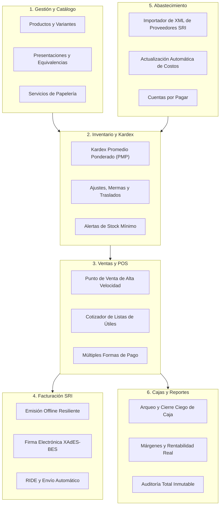

# 01. Visión y Alcance del Proyecto LumsaLibrary

> **Estado:** Documento Normativo Obligatorio (Vigencia: 2026 – 2046+)  
> **Ámbito:** ERP Integral de Gestión y Facturación para Librería y Papelería en Ecuador

---

## 1. Declaración de Visión (Horizonte a 20 Años)

**LumsaLibrary** está concebido para ser el núcleo operativo, contable, logístico y comercial de una librería y papelería ecuatoriana, diseñado bajo principios de ingeniería de software que aseguren su **operatividad, escalabilidad, mantenibilidad e independencia tecnológica durante al menos dos décadas**.

Las interfaces de usuario y los frameworks evolucionan rápidamente, pero las matemáticas del comercio, el control estricto de inventarios y la normativa tributaria obedecen a principios formales permanentes. LumsaLibrary separa las reglas esenciales del negocio de las herramientas tecnológicas temporales.

---

## 2. El Modelo de Negocio: Librería y Papelería en Ecuador

En Ecuador, una "librería" no es una simple tienda de libros; es un centro integral de suministros educativos, de oficina, bazar y servicios auxiliares. Este modelo posee particularidades comerciales críticas:

### 2.1. Dinámica de Catálogo y Fraccionamiento
* **Bimodalidad Mayorista / Minorista:** Se adquieren productos en empaques maestros (cajas de 50 esferos, bultos de 10 resmas, paquetes de 100 cartulinas) y se comercializan en múltiples presentaciones: por unidad suelta, docena, medio ciento, resma o caja completa.
* **Artículos sin Código de Barras:** Gran volumen de ítems de bajo costo unitario (borradores individuales, pliegos de papel cometa, cartulinas escolares, fomix, cintas por metro) que requieren búsqueda rápida fonética, por alias o código corto interno.
* **Combos y Kits de Temporada:** Paquetes escolares que agrupan decenas de artículos independientes descargando automáticamente sus existencias del inventario.

### 2.2. Temporadas Escolares (Picos Operativos Críticos)
El año comercial ecuatoriano está determinado por dos regímenes educativos:
1. **Régimen Costa y Galápagos:** Inicio de clases entre abril y mayo.
2. **Régimen Sierra y Amazonía:** Inicio de clases entre agosto y septiembre.

Durante estas temporadas:
* El tráfico en mostrador se multiplica por 10x a 20x.
* Se reciben **listas escolares completas** (40 a 80 ítems por estudiante).
* El sistema **no puede bloquearse ni depender de la latencia de internet**. Cada segundo en caja define la rentabilidad y satisfacción del cliente.

### 2.3. Servicios de Valor Agregado
* Impresiones, fotocopias, anillados, plastificados, escaneos y bazar.
* Servicios que se cobran en el mismo ticket/factura pero no descuentan inventario físico unitario tradicional, aunque sí registran ingresos y costos operativos.

---

## 3. Alcance Funcional del Sistema

El sistema cubre integralmente seis macroprocesos:

---

## 4. Límites del Sistema (Lo que el ERP NO debe hacer)

Para garantizar la longevidad del sistema, se definen límites de responsabilidad claros:
* **No es un software contable general de doble partida completo:** Se enfoca en inventario, ventas, compras, caja y fiscalidad SRI. Exportará interfaces estandarizadas a sistemas contables externos si es requerido.
* **No es una plataforma de e-commerce pública con CMS integrado:** La lógica del ERP expone APIs para conectarse a canales de venta online, pero el ERP prioriza la operación de punto de venta físico e inventario centralizado.
* **No ejecuta lógica de negocio en el cliente:** Ninguna regla de precio, descuento, validación de stock o cálculo de impuestos puede residir en el navegador web. Todo cálculo reside en el núcleo del servidor.

---

## 5. Glosario Oficial de Términos Ecuatorianos

| Término | Definición en LumsaLibrary |
|---|---|
| **SRI** | Servicio de Rentas Internas de Ecuador. Ente regulador tributario. |
| **RUC** | Registro Único de Contribuyentes (13 dígitos numéricos). |
| **Cédula** | Cédula de Identidad de Ecuador (10 dígitos numéricos). |
| **Consumidor Final** | Identificación genérica (`9999999999999`) con límite legal máximo de $50 USD. |
| **RIDE** | Representación Impresa del Documento Electrónico (PDF oficial reglamentario del SRI). |
| **Clave de Acceso** | Código único de 49 dígitos numéricos con algoritmo Módulo 11 que identifica cada comprobante electrónico. |
| **RIMPE** | Régimen Simplificado para Emprendedores y Negocios Populares. Requiere leyendas tributarias específicas en facturas. |
| **Kardex PMP** | Registro oficial de movimientos valorado al Precio Medio Ponderado para fines fiscales y de costo de ventas. |
| **Lista de Útiles** | Conjunto cotizable y agrupable de materiales escolares solicitados por instituciones educativas. |
| **Fraccionamiento** | Conversión de un empaque mayorista en unidades menores de venta con control estricto de inventario. |
