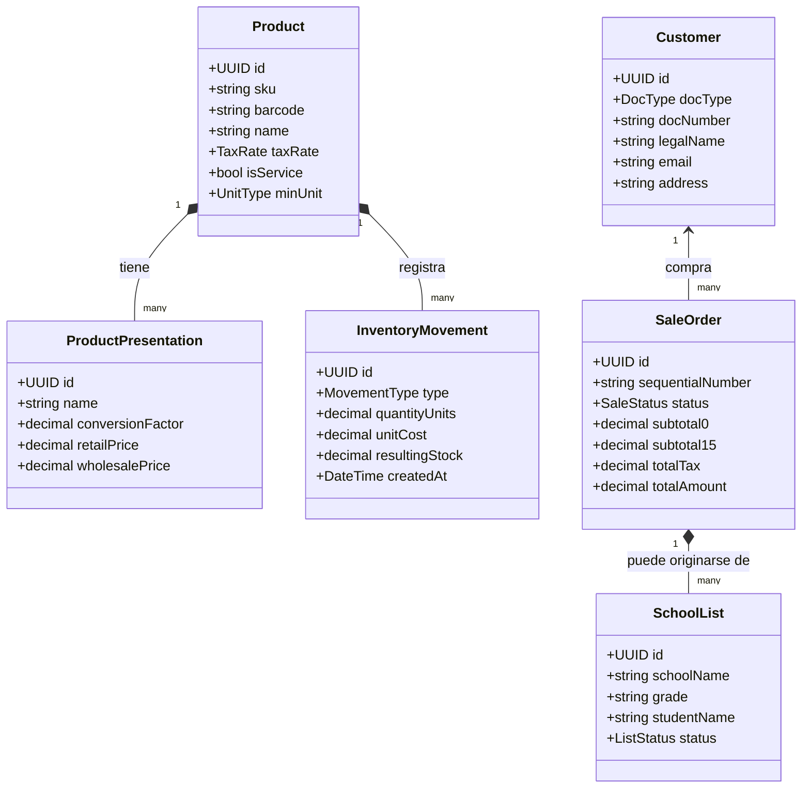

# 03. Modelo del Dominio y Reglas del Negocio

> **Estado:** Documento Normativo Obligatorio  
> **Enfoque:** Domain-Driven Design (DDD) adaptado al comercio ecuatoriano

---

## 1. Mapeo de Contextos Delimitados (Bounded Contexts)

---

## 2. Catálogo y Fraccionamiento (Módulo de Productos)

### 2.1. Entidad `Product` (Producto Base)
Representa la definición universal del artículo o servicio:
* `id`: UUIDv7.
* `sku`: Código interno único autogenerado (ej. `PAP-00124`).
* `barcode`: Código de barras EAN-13 / UPC del fabricante (opcional para ítems sueltos).
* `name`: Nombre descriptivo (ej. *"Cuaderno Universitario Líneas 100h Norma"*).
* `category_id`: Categoría taxonómica (Escolar, Oficina, Arte, Papeles, Bazar, Servicios).
* `brand_id`: Marca del fabricante.
* `tax_rate`: `IVA_0` | `IVA_15` | `NO_OBJETO` | `EXENTO`.
* `is_service`: Booleano (si es `true`, no genera movimientos de Kardex; ej: fotocopias).
* `min_unit`: Unidad de medida mínima indivisible (`UNIDAD`, `PLIEGO`, `METRO`, `JUEGO`, `SERVICIO`).

### 2.2. Entidad `ProductPresentation` (Presentación Comercial)
Permite vender un producto en distintos formatos y empaques con precios dinámicos:
* `id`: UUIDv7.
* `product_id`: Referencia al producto padre.
* `name`: Nombre de la presentación (*"Unidad"*, *"Docena"*, *"Caja x 50"*, *"Resma x 500"*).
* `conversion_factor`: Cantidad de unidades mínimas que contiene.
  * *Ejemplo:* Si el producto es *"Esfero Bic Azul"* (unidad mínima = 1):
    * Presentación Unidad: `conversion_factor = 1.0`.
    * Presentación Docena: `conversion_factor = 12.0`.
    * Presentación Caja: `conversion_factor = 50.0`.
* `barcode`: Código de barras específico del empaque (si el fabricante asignó un código a la caja).
* `retail_price`: Precio de venta al público para consumidor minorista.
* `wholesale_price`: Precio de venta al por mayor.
* `min_wholesale_quantity`: Cantidad mínima para aplicar precio mayorista automáticamente.

---

## 3. Inventario y Kardex (Reglas de Valoración)

### 3.1. Método de Valoración Oficial: Precio Medio Ponderado (PMP)
Por exigencia tributaria en Ecuador para el cálculo del costo de ventas deducible:

$$\text{Nuevo Costo PMP} = \frac{(\text{Stock Anterior} \times \text{Costo Anterior}) + (\text{Cantidad Comprada} \times \text{Costo Compra})}{\text{Stock Anterior} + \text{Cantidad Comprada}}$$

* **Las ventas no alteran el Costo Unitario Promedio**, solo disminuyen el stock y valorizan la salida al PMP vigente.
* **Las devoluciones de clientes** reingresan al inventario al costo PMP registrado en la venta original.

---

## 4. Clientes e Identificación Tributaria Ecuatoriana

### 4.1. Tipos de Identificación Soportados
1. **Cédula de Identidad (Tipo 05):** 10 dígitos numéricos. Verificación obligatoria mediante algoritmo de Módulo 10 con coeficientes `[2, 1, 2, 1, 2, 1, 2, 1, 2]`.
2. **RUC Persona Natural (Tipo 04):** 13 dígitos numéricos. Primeros 10 dígitos corresponden a una cédula válida + sufijo `001` (o establecimiento registrado).
3. **RUC Sociedad Privada (Tipo 04):** 13 dígitos. Tercer dígito es siempre `9`. Verificación obligatoria mediante Módulo 11 con coeficientes `[4, 3, 2, 7, 6, 5, 4, 3, 2]`.
4. **RUC Entidad Pública (Tipo 04):** 13 dígitos. Tercer dígito es siempre `6`. Verificación obligatoria mediante Módulo 11 con coeficientes `[3, 2, 7, 6, 5, 4, 3, 2]`.
5. **Pasaporte / Identificación Extranjera (Tipo 06 / 08):** Alfanumérico sin validación de dígitos verificadores ecuatorianos.
6. **Consumidor Final (Tipo 07):** Identificación estándar `9999999999999`.

### 4.2. Regla Fiscal del Consumidor Final ($50 USD)
> [!IMPORTANT]
> **Normativa SRI vigente:** Si el total de la venta es superior a **$50.00 USD**, el sistema **bloquea la emisión a Consumidor Final** y exige obligatoriamente los nombres completos, número de cédula/RUC, correo y dirección del cliente.

---

## 5. Ventas y Punto de Venta (POS)

### 5.1. Sesión y Control de Caja
* **Apertura de Caja:** Declaración del monto inicial en efectivo (*fondo de sencillo*).
* **Movimientos de Caja durante el turno:**
  * Ingreso extraordinario (aportes de cambio).
  * Egreso extraordinario (pago a proveedores menores, retiro de seguridad).
* **Cierre Ciego de Caja:** El cajero declara el dinero físico contado sin ver el sistema. El sistema calcula y reporta el sobrante o faltante exacto para el administrador.

### 5.2. Formas de Pago Admitidas (Alineadas al SRI)
1. **Efectivo** (Código SRI 01).
2. **Transferencias Bancarias / DeUna / Banco Pichincha / Bancos Locales** (Código SRI 20 - Otros con utilización del sistema financiero).
3. **Tarjeta de Débito** (Código SRI 16).
4. **Tarjeta de Crédito** (Código SRI 19).
5. **Crédito de Librería / Cuenta Corriente de Cliente** (Código SRI 20, con control de límite de crédito y fecha de vencimiento).
* **Pagos mixtos permitidos:** Una sola venta puede pagarse combinando múltiples formas de pago (ej. $10 en efectivo + $15 por transferencia).

---

## 6. Módulo Especializado: Listas de Útiles Escolares

Permite gestionar la demanda crítica de las temporadas Costa y Sierra:
1. **Carga y Cotización:** Se registra el listado solicitado por la escuela/colegio.
2. **Verificación de Disponibilidad en Tiempo Real:** Identifica qué ítems están en stock y cuáles requieren pedido al proveedor.
3. **Separación y Reserva:** Permite al padre de familia abonar un porcentaje (anticipo) y reservar los materiales.
4. **Facturación y Despacho:** Al completar el retiro, se liquida la venta en un solo clic emitiendo la factura electrónica y descargando el Kardex.

---

## 7. Compras e Importación de XML del SRI

> [!TIP]
> **Ventaja de Productividad:** En Ecuador, todas las compras de proveedores ya cuentan con un archivo XML autorizado por el SRI.

* El ERP incluye un **Lector/Parser de Facturas Electrónicas de Proveedores**.
* El usuario simplemente sube el XML de su compra:
  1. El sistema lee el RUC y razón social del proveedor.
  2. Mapea los códigos de productos del proveedor con los códigos internos.
  3. Si un producto no existe en el catálogo, permite crearlo en el momento.
  4. Carga automáticamente las cantidades y costos de compra al Kardex, actualizando el PMP sin digitación manual.
