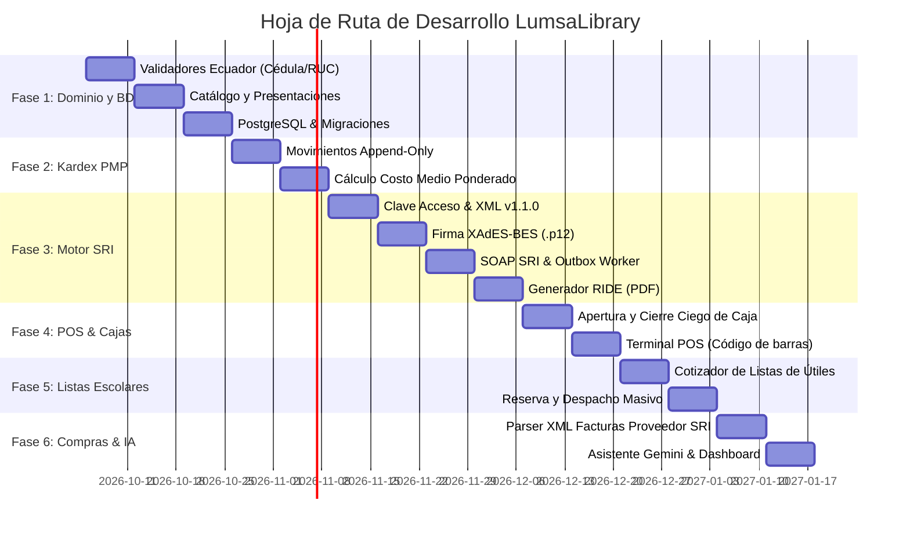

# 06. Plan de Implementación y Hoja de Ruta

> **Estado:** Documento Normativo Obligatorio  
> **Estrategia:** Desarrollo incremental guiado por dominio (Domain-Driven Roadmap)

---

## Cronograma por Fases de Desarrollo

---

## Detalle y Criterios de Aceptación por Fase

### Fase 1: Fundaciones del Dominio e Identidad Ecuatoriana
* **Objetivos:**
  * Implementar el validador oficial de Cédula y RUC en TypeScript puro con cobertura de pruebas unitarias al 100%.
  * Modelar las entidades de `Product` y `ProductPresentation` con soporte de fraccionamiento.
  * Configurar la base de datos relacional PostgreSQL y el sistema de migraciones.
* **Criterio de Aceptación:**
  * Toda cédula y RUC válido en Ecuador es aceptado; números inválidos son rechazados con mensajes claros.
  * Se pueden definir productos con presentaciones múltiples (ej. 1 caja = 50 unidades) sin ambigüedad.

---

### Fase 2: Motor de Inventario y Kardex PMP
* **Objetivos:**
  * Crear la tabla inmutable `inventory_movements`.
  * Implementar el algoritmo de Precio Medio Ponderado (PMP).
  * Casos de uso para compras, ventas, mermas internas y ajustes de inventario.
* **Criterio de Aceptación:**
  * Ninguna operación actualiza el stock directamente; todo cálculo deriva del historial de movimientos.
  * El Kardex cuadra matemáticamente en costo total y stock físico.

---

### Fase 3: Motor Fiscal SRI (Ecuador)
* **Objetivos:**
  * Algoritmo determinista de Clave de Acceso (49 dígitos, Módulo 11).
  * Generador de XML conforme al esquema `factura_V1.1.0.xsd`.
  * Módulo de firma digital criptográfica XAdES-BES mediante certificado `.p12`.
  * Cliente SOAP para Web Services de Recepción y Autorización (Ambiente de Pruebas).
  * Generador de RIDE en formato PDF con código de barras Code 128.
  * Cola transaccional Outbox para desacoplar el POS del tiempo de respuesta del SRI.
* **Criterio de Aceptación:**
  * Emisión de una factura de prueba que sea recibida y autorizada exitosamente por el servidor de pruebas del SRI (`celcer.sri.gob.ec`).

---

### Fase 4: Punto de Venta (POS) y Control de Caja
* **Objetivos:**
  * Interfaz de terminal POS de alta velocidad, operable 100% mediante teclado y lector de código de barras.
  * Búsqueda fonética y por palabras clave para artículos de papelería sin código de barras.
  * Múltiples formas de pago (Efectivo, Tarjeta, Transferencia, Crédito directo).
  * Control estricto de caja: Apertura, ingresos/egresos menores y cierre ciego con reporte de descuadres.
  * Impresión de tickets térmicos (80mm y 58mm).
* **Criterio de Aceptación:**
  * Registro y cobro de una venta completado en menos de 5 segundos en mostrador.

---

### Fase 5: Temporada Escolar y Listas de Útiles
* **Objetivos:**
  * Módulo de carga y cotización rápida de listas escolares.
  * Validación automática de existencias con sugerencia de productos sustitutos en caso de falta de stock.
  * Control de reservas con abonos iniciales.
  * Facturación y despacho en 1 clic.
* **Criterio de Aceptación:**
  * Cotizar una lista escolar de 50 ítems en menos de 2 minutos.

---

### Fase 6: Compras, Importador de XML SRI e Inteligencia Artificial
* **Objetivos:**
  * Parser automático de XML de facturas electrónicas emitidas por proveedores. Carga masiva de stock y costos sin digitación manual.
  * Integración de Google AI Studio (Gemini) para análisis predictivo de compras para temporadas Costa/Sierra.
  * Asistente inteligente en mostrador para recomendaciones y búsqueda semántica de útiles.
  * Dashboard ejecutivo con métricas de ventas, rentabilidad real y margen neto.
* **Criterio de Aceptación:**
  * Subir un XML de proveedor de $1,000 USD y ver el inventario actualizado con sus nuevos costos en menos de 3 segundos.
