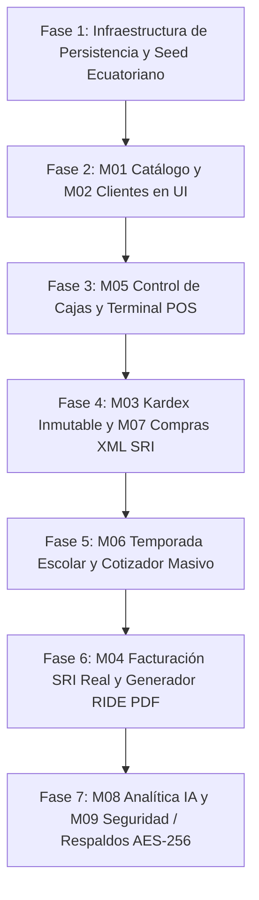

# 07. Trazabilidad, Estado de Implementación y Protocolo de Verificación

> **Estado:** Documento Normativo Activo  
> **Propósito:** Registro auditable del avance real del sistema, diagnóstico de desviaciones, matriz de madurez por capas y criterios de verificación comprobables para garantizar la continuidad del desarrollo por cualquier desarrollador o agente de IA.  
> **Fecha de Creación:** 04 de Octubre de 2026  
> **Última Actualización:** 04 de Octubre de 2026  

---

## 1. Diagnóstico Técnico y Auditoría de Desviación Inicial

### 1.1 Antecedentes y Auditoría Realizada
En la revisión del 04 de Octubre de 2026, se sometió el sistema a una inspección desde la perspectiva del **Usuario Final** (cajero, administrador de librería y contador en Ecuador). Se identificaron dos realidades contrastantes:

1. **Fortaleza en Capas Profundas (Backend y Dominio):**
   - Se diseñaron e implementaron los módulos M00 a M09 siguiendo principios de Clean Architecture.
   - Existen **126 pruebas unitarias automatizadas (Vitest)** aprobadas al 100% en 25 archivos de prueba.
   - Se cuenta con validadores oficiales de Cédula y RUC (Módulo 10 y 11), motor inmutable de Kardex PMP, esquemas de DDL en Drizzle para PostgreSQL, constructores de XML v1.1.0 del SRI y firma criptográfica XAdES-BES.

2. **Desviación Crítica en la Capa de Presentación (Frontend):**
   - Ante la solicitud inicial de visualizar el sistema en el navegador, se construyó una pantalla monolítica en `src/app/page.tsx` basada exclusivamente en estados en memoria (`useState`).
   - **Diagnóstico:** Dicha pantalla constituye una **maqueta/prototipo volátil**, no un ERP operativo.
   - **Deficiencias para el Usuario Final:**
     - **Pérdida Total de Datos:** Al recargar la página (F5), se destruyen todas las ventas, cotizaciones y registros.
     - **Desconexión de Base de Datos:** No existe persistencia en PostgreSQL ni comunicación con los esquemas de Drizzle.
     - **Violación de la Regla #1 de `AGENTS.md`:** Se duplicó lógica en componentes de React en lugar de orquestar los casos de uso del dominio mediante Server Actions o rutas de API.
     - **Inoperatividad Comercial:** No permite crear productos reales, no conecta con lectores USB de código de barras para venta rápida, no gestiona apertura ni cierre ciego de caja física, no permite subir archivos `.xml` reales de proveedores del SRI y no emite comprobantes fiscales autorizados ni RIDE en PDF.

### 1.2 Declaración Normativa
Queda formalmente obsoleta y en proceso de sustitución la maqueta monolítica de `src/app/page.tsx`. Ningún módulo se considerará completado mientras no cuente con persistencia real, validación de servidor y operatividad transaccional comprobable contra la base de datos.

---

## 2. Matriz de Trazabilidad y Madurez por Módulo

El progreso del sistema se audita a través de **5 Capas de Ingeniería**:

* **Capa 1: Dominio Puro:** Entidades, Value Objects y Reglas de Negocio (`domain/`).
* **Capa 2: Base de Datos (DDL):** Esquemas Drizzle, tipos, índices y migraciones (`infrastructure/database/`).
* **Capa 3: Aplicación / Casos de Uso:** Orquestadores y lógica transaccional (`application/use-cases/`).
* **Capa 4: Interfaces Web / API:** Rutas REST / Server Actions con validación Zod (`app/api/` o actions).
* **Capa 5: Interfaz Operativa (UI):** Pantallas interactivas reales conectadas a datos persistentes (`app/`).

### Estado Actual por Módulo (Semáforo de Madurez)

| Código | Módulo | Capa 1: Dominio | Capa 2: DDL / DB | Capa 3: Casos de Uso | Capa 4: API / Web | Capa 5: UI Operativa | % Madurez Real |
|---|---|:---:|:---:|:---:|:---:|:---:|:---:|
| **M00** | Core & Fundaciones | ✅ 100% | ✅ 100% | ✅ 100% | ⚠️ 50% | ⚠️ 20% | **74%** |
| **M01** | Catálogo & Fraccionamiento | ✅ 100% | ✅ 100% | ⚠️ 70% | ❌ 0% | ❌ 0% | **54%** |
| **M02** | Clientes & Identidad Ecuador | ✅ 100% | ✅ 100% | ⚠️ 70% | ❌ 0% | ❌ 0% | **54%** |
| **M03** | Kardex & Inventario PMP | ✅ 100% | ✅ 100% | ⚠️ 70% | ❌ 0% | ❌ 0% | **54%** |
| **M04** | Motor Fiscal SRI (Ecuador) | ✅ 100% | ✅ 100% | ⚠️ 70% | ❌ 0% | ❌ 0% | **54%** |
| **M05** | POS & Control de Cajas | ✅ 100% | ✅ 100% | ⚠️ 70% | ❌ 0% | ❌ 0% | **54%** |
| **M06** | Temporada Escolar & Listas | ✅ 100% | ✅ 100% | ⚠️ 70% | ❌ 0% | ❌ 0% | **54%** |
| **M07** | Compras & Parser XML SRI | ✅ 100% | ✅ 100% | ⚠️ 70% | ❌ 0% | ❌ 0% | **54%** |
| **M08** | Analítica & IA (Gemini) | ✅ 100% | ✅ 100% | ⚠️ 70% | ⚠️ 50% | ❌ 0% | **64%** |
| **M09** | Configuración & Respaldos | ✅ 100% | ✅ 100% | ⚠️ 70% | ❌ 0% | ❌ 0% | **54%** |

*Leyenda: ✅ Implementado y Verificado con Tests / ⚠️ Parcial o en Progreso / ❌ Pendiente de Implementación.*

---

## 3. Protocolo Obligatorio de Verificación (Verification Gates)

Para que una tarea o fase pueda marcarse como completada (`[x]`), **DEBE SUPERAR OBLIGATORIAMENTE LAS SIGUIENTES 4 PUERTAS DE VERIFICACIÓN**:

### Puerta 1: Verificación de Código y Tipado (Estática)
- Comando: `npm run type-check` (0 errores de TypeScript con `strict: true`).
- Comando: `npm run lint` (0 errores de ESLint, sin `any`, sin funciones impuras en render).

### Puerta 2: Verificación de Dominio (Pruebas Automatizadas)
- Comando: `npm test` (El 100% de los tests unitarios deben aprobar).
- Todo nuevo caso de uso o entidad debe incluir su archivo `.spec.ts` correspondiente.

### Puerta 3: Verificación de Persistencia (Base de Datos)
- Los esquemas deben sincronizarse con PostgreSQL (`drizzle-kit push` o migraciones).
- Debe existir un script de prueba o verificación que inserte y consulte registros reales, comprobando que las claves foráneas, restricciones de unicidad e índices operan correctamente.

### Puerta 4: Verificación de Experiencia de Usuario (E2E / Pantalla Operativa)
- La pantalla debe permitir al usuario ejecutar el flujo comercial real.
- **Prueba de Persistencia F5:** Al crear un registro en la interfaz y recargar la página en el navegador, el registro debe continuar visible, habiéndose recuperado de PostgreSQL.
- Prohibido el uso de colecciones ficticias en `useState` para sustituir llamadas al backend.

---

## 4. Hoja de Ruta de Implementación Verificable (Paso a Paso)



### FASE 1: Infraestructura de Persistencia y Seed de Datos Ecuatorianos
* **Objetivo:** Conectar la aplicación a una base de datos PostgreSQL real, aplicar esquemas de Drizzle y poblar el sistema con datos reales de una papelería en Ecuador.
* **Tareas Específicas:**
  - [ ] **1.1:** Configurar `docker-compose.yml` para levantar PostgreSQL 16 y crear scripts de inicio rápido.
  - [ ] **1.2:** Aplicar Drizzle DDL contra la base de datos (`npm run db:push`).
  - [ ] **1.3:** Crear script de `seed` (`src/modules/core/infrastructure/database/seed.ts`) que inserte:
    - 50 productos reales de librería/papelería (Norma, Faber-Castell, BIC, Pelikan, etc.) con códigos EAN-13, costos, PVP y presentaciones (cajas y unidades).
    - Categorías de papelería ecuatoriana (Escolar, Oficina, Bellas Artes, Didácticos, Libros).
    - Clientes de prueba con Cédulas y RUCs válidos (Módulo 10 y 11) y el Consumidor Final predeterminado.
    - Datos fiscales de la empresa emisora (RUC, matriz, establecimiento, punto de emisión).
* **Criterio de Comprobación:**
  - Ejecutar `npm run db:seed` y verificar con consulta SQL que existen 50+ productos y clientes en PostgreSQL.

---

### FASE 2: M01 Catálogo de Productos y M02 Clientes en UI
* **Objetivo:** Construir las interfaces y Server Actions que permitan gestionar el inventario base y la cartera de clientes.
* **Tareas Específicas:**
  - [ ] **2.1:** Implementar Server Actions / API Routes para Catálogo (`getProducts`, `createProduct`, `updateProduct`, `searchByBarcode`).
  - [ ] **2.2:** Pantalla de Catálogo (`/catalog`): Búsqueda en tiempo real por nombre o código de barras, paginación, formulario para nuevo producto con presentaciones (unidad/caja) e indicación de tarifa IVA (0% o 15%).
  - [ ] **2.3:** Implementar Server Actions / API Routes para Clientes (`getCustomers`, `createCustomer`, `validateIdentification`).
  - [ ] **2.4:** Pantalla de Clientes (`/customers`): Formulario con validador reactivo de Cédula/RUC ecuatoriano en el cliente y servidor, advertencia de Consumidor Final y listado de clientes.
* **Criterio de Comprobación:**
  - Crear un producto nuevo desde la UI con código de barras `7861001234567`.
  - Recargar el navegador y buscar por dicho código: el producto debe aparecer con su presentación y precio.
  - Intentar crear un cliente con cédula inválida (`1710000001`): el sistema debe bloquear el envío y mostrar el error del Módulo 10.

---

### FASE 3: M05 Control de Cajas y Terminal POS
* **Objetivo:** Proveer la interfaz de venta ultrarrápida de mostrador con control riguroso de efectivo.
* **Tareas Específicas:**
  - [ ] **3.1:** Pantalla y flujo de **Apertura de Caja**: Registrar monto inicial en efectivo (ej. $30.00 en suelto) vinculado al cajero y punto de emisión.
  - [ ] **3.2:** Terminal de Venta POS (`/pos`):
    - Input de escaneo continuo para pistola lectora USB de códigos de barras (adición inmediata al carrito sin tocar el ratón).
    - Búsqueda difusa para artículos sueltos sin código.
    - Aplicación automática de precios por presentación (unidad vs caja).
    - Validación automática de la regla SRI de Consumidor Final (máximo $50).
  - [ ] **3.3:** Transacción de Cobro:
    - Registrar la venta en base de datos.
    - Descontar el stock mediante movimiento inmutable en `inventory_movements`.
    - Generar el ticket de impresión ESC/POS.
  - [ ] **3.4:** Pantalla y flujo de **Cierre Ciego de Caja**:
    - Formulario donde el cajero desglosa monedas y billetes contados físicamente.
    - El sistema compara contra el dinero esperado del sistema y genera el acta de arqueo (con reporte de sobrantes/faltantes).
* **Criterio de Comprobación:**
  - Abrir caja con $20.00.
  - Escanear 2 productos, cobrar en efectivo con $10.00, registrar vuelto.
  - Realizar cierre ciego de caja: verificar que el arqueo cuadre exactamente y que el stock de los productos se haya reducido en PostgreSQL.

---

### FASE 4: M03 Kardex Inmutable y M07 Compras XML SRI
* **Objetivo:** Garantizar la trazabilidad del inventario y permitir la importación automática de facturas de proveedores.
* **Tareas Específicas:**
  - [ ] **4.1:** Pantalla de Visualización de Kardex (`/kardex`): Tabla cronológica de movimientos por producto (Entradas, Salidas, Costo Unitario, Saldo Físico y PMP ponderado).
  - [ ] **4.2:** Pantalla de Compras de Proveedores (`/purchasing`):
    - Componente `<input type="file" accept=".xml">` para subir facturas electrónicas reales emitidas por proveedores.
    - Extracción de datos del XML con `fast-xml-parser` (RUC, número de factura, detalles de productos, impuestos).
    - Interfaz de homologación: permitir mapear productos nuevos del XML a productos existentes en catálogo.
    - Confirmación de compra: creación de movimiento de Kardex, recálculo de PMP y registro en cuentas por pagar (`supplier_debts`).
* **Criterio de Comprobación:**
  - Subir un archivo `.xml` de factura electrónica del SRI de un proveedor.
  - Confirmar el ingreso: verificar que el Kardex registre la entrada con el nuevo costo y que el stock total aumente en la base de datos.

---

### FASE 5: M06 Temporada Escolar y Listas de Útiles
* **Objetivo:** Automatizar la gestión de listas escolares durante la temporada alta (Costa y Sierra).
* **Tareas Específicas:**
  - [ ] **5.1:** Pantalla de Configuración de Instituciones y Grados Escolares (`/school-lists/institutions`).
  - [ ] **5.2:** Carga y Gestión de Listas Maestras por Grado (`/school-lists/templates`): Definir listas sugeridas (ej. 4to Grado EGB - Colegio San Gabriel).
  - [ ] **5.3:** Cotizador de Mostrador para Clientes (`/school-lists/quote`):
    - Seleccionar colegio y grado para cargar la lista en 1 clic.
    - Ajustar cantidades según lo que el padre de familia ya tenga en casa.
    - Generar cotización en PDF y botón para enviar detalle por WhatsApp (`+593`).
    - Botón de **Reserva con Abono** (reserva de existencias para que no se vendan en el POS general).
    - Botón de **Despacho Inmediato al POS** para cobro en caja.
* **Criterio de Comprobación:**
  - Cotizar una lista escolar, registrar abono del 50%, verificar la reserva de inventario y luego completar la venta en el POS.

---

### FASE 6: M04 Facturación Electrónica SRI Real
* **Objetivo:** Conectar el sistema con los Web Services del SRI para emisión formal en ambiente de pruebas y producción.
* **Tareas Específicas:**
  - [ ] **6.1:** Configuración de Certificado Digital (`.p12`): Interfaz para subir firma electrónica y contraseña cifrada.
  - [ ] **6.2:** Generación y Firma de Factura XML: Integración del servicio XAdES-BES con la Clave de Acceso de 49 dígitos.
  - [ ] **6.3:** Transmisión al Web Service del SRI (`celcer.sri.gob.ec`): Recepción y Autorización de comprobantes con cola de reintentos (Outbox Pattern).
  - [ ] **6.4:** Generador de RIDE oficial en PDF con código de barras Code 128 y logotipos de la empresa.
* **Criterio de Comprobación:**
  - Emitir una factura electrónica en ambiente de pruebas, recibir autorización del SRI y descargar el PDF RIDE con su clave de 49 dígitos.

---

### FASE 7: M08 Analítica con IA y M09 Respaldos / Seguridad
* **Objetivo:** Proveer inteligencia de negocio, prevención de desastres y control de accesos.
* **Tareas Específicas:**
  - [ ] **7.1:** Dashboard de Analítica: Rentabilidad real (Ventas menos Costo de Ventas PMP), margen bruto, productos de mayor y menor rotación (*hueso*).
  - [ ] **7.2:** Asistente Gemini de Mostrador y Compras: Chat contextualizado con el catálogo real para búsqueda de sustitutos y sugerencias de compra para temporada Costa/Sierra.
  - [ ] **7.3:** Sistema de Respaldos Automatizados: Botón y cron job para generar copias de seguridad de PostgreSQL cifradas con AES-256 y hash SHA-256.
  - [ ] **7.4:** Control de Roles y Accesos (RBAC): Login para Cajeros (solo POS y cierre), Bodegueros (Kardex y compras) y Administradores (todo el sistema).
* **Criterio de Comprobación:**
  - Ejecutar un respaldo desde la UI, verificar la creación del archivo cifrado `.sql.enc` y restaurarlo en una base de datos limpia para verificar integridad.

---

## 5. Bitácora de Verificación y Control de Cambios

Cada sesión de desarrollo debe registrar su avance en esta bitácora con los comandos ejecutados y resultados comprobados:

| Fecha | Commit | Tarea / Hito | Evidencia Comprobable | Verificado Por |
|---|---|---|---|---|
| 2026-10-04 | `2b5183a` | M00 - M09 Dominio Backend | 126 tests unitarios pasando en Vitest (`npm test`). Type-check y ESLint aprobados. | Auditoría Inicial |
| 2026-10-04 | Pendiente | Fase 1: Docker PostgreSQL & Seed | Pendiente de ejecución | En espera |

---

## 6. Comandos Oficiales de Auditoría para Cualquier Agente o Desarrollador

Cualquier persona o modelo de IA que asuma el proyecto en cualquier momento **debe ejecutar estos comandos para verificar el estado de salud del sistema**:

```bash
# 1. Verificar tipado estricto (0 errores permitidos)
npm run type-check

# 2. Verificar estilo y reglas de arquitectura (0 errores permitidos)
npm run lint

# 3. Ejecutar suite completa de pruebas unitarias
npm test

# 4. Verificar estado de la base de datos contra el esquema Drizzle
npx drizzle-kit check

# 5. Comprobar que no existan tareas pendientes sin documentar en este archivo
git status
```
