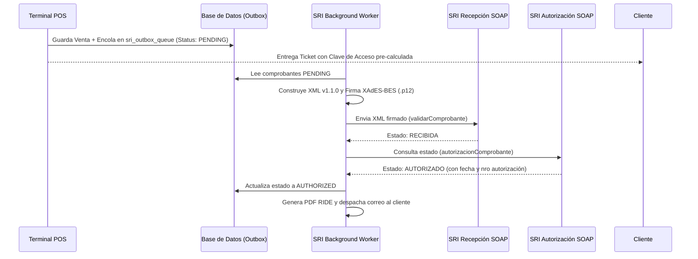

# Módulo 04: Motor Fiscal de Facturación SRI (`billing-sri`)

> **Módulo:** `billing-sri`  
> **Estado:** Especificación Técnica y Plan de Implementación Aprobado  
> **Dependencias:** `core-infrastructure` (Módulo 00), `stakeholders` (Módulo 02)

---

## 1. Objetivo y Alcance

### 1.1. Objetivo
Gestionar el ciclo de vida completo de los comprobantes electrónicos legales conforme a las especificaciones técnicas del **Servicio de Rentas Internas (SRI) de Ecuador**, garantizando emisión offline inmediata en caja y sincronización asíncrona tolerante a fallos.

### 1.2. Alcance
* Generación determinista de la **Clave de Acceso de 49 dígitos** con cálculo de dígito verificador Módulo 11 ponderado (pesos 2 a 7).
* Construcción estricta de documentos XML versión 1.1.0 para Facturas (código 01) y Notas de Crédito (código 04).
* Firma electrónica digital bajo el estándar **XAdES-BES** utilizando archivos de certificado PKCS#12 (`.p12`).
* Conexión cliente SOAP a los Web Services oficiales de **Recepción** y **Autorización** del SRI (ambientes de Pruebas y Producción).
* Implementación del patrón **Transactional Outbox (`sri_outbox_queue`)** para garantizar que la caja registre la venta sin esperar la respuesta del SRI.
* Generador de la **Representación Impresa (RIDE)** en formato PDF con código de barras **Code 128**.
* Despacho automático por correo electrónico del XML autorizado y el PDF RIDE al cliente.

### 1.3. Exclusiones
* No realiza el cobro del dinero ni cuadres de caja (responsabilidad del Módulo 05: `pos`).

---

## 2. Modelo del Dominio y Ficha Técnica SRI



---

## 3. Diseño de Persistencia (PostgreSQL)

```sql
CREATE TYPE sri_environment_enum AS ENUM ('TEST', 'PRODUCTION');
CREATE TYPE sri_invoice_status_enum AS ENUM (
    'PENDING_GENERATION',
    'SIGNED',
    'TRANSMITTED',
    'RECEIVED',
    'AUTHORIZED',
    'REJECTED',
    'NOT_AUTHORIZED',
    'CANCELLED'
);

-- Configuración de la librería ante el SRI
CREATE TABLE sri_company_configs (
    id UUID PRIMARY KEY,
    ruc VARCHAR(13) NOT NULL UNIQUE,
    legal_name VARCHAR(255) NOT NULL,
    trade_name VARCHAR(255) NOT NULL,
    main_address TEXT NOT NULL,
    branch_address TEXT NOT NULL,
    establishment_code VARCHAR(3) DEFAULT '001' NOT NULL,
    emission_point_code VARCHAR(3) DEFAULT '001' NOT NULL,
    is_accounting_obligated BOOLEAN DEFAULT FALSE NOT NULL,
    is_rimpe_entrepreneur BOOLEAN DEFAULT FALSE NOT NULL,
    is_rimpe_popular_business BOOLEAN DEFAULT FALSE NOT NULL,
    retention_agent_resolution VARCHAR(50),
    environment sri_environment_enum DEFAULT 'TEST' NOT NULL,
    certificate_p12_path VARCHAR(255),
    certificate_password_hash TEXT, -- Encriptado con clave de aplicación
    updated_at TIMESTAMP WITH TIME ZONE DEFAULT CURRENT_TIMESTAMP NOT NULL
);

-- Control Atómico de Secuenciales por Punto de Emisión y Tipo de Documento
CREATE TABLE sri_sequentials (
    establishment_code VARCHAR(3) NOT NULL,
    emission_point_code VARCHAR(3) NOT NULL,
    document_type_code VARCHAR(2) NOT NULL, -- '01': Factura, '04': Nota de Crédito
    current_sequential INTEGER DEFAULT 0 NOT NULL,
    PRIMARY KEY (establishment_code, emission_point_code, document_type_code)
);

-- Comprobantes Electrónicos Emitidos (Facturas y Notas de Crédito)
CREATE TABLE electronic_invoices (
    id UUID PRIMARY KEY,
    document_type_code VARCHAR(2) DEFAULT '01' NOT NULL, -- '01' o '04'
    access_key VARCHAR(49) NOT NULL UNIQUE,
    establishment_code VARCHAR(3) NOT NULL,
    emission_point_code VARCHAR(3) NOT NULL,
    sequential_number VARCHAR(9) NOT NULL,
    emission_date DATE NOT NULL,
    customer_id UUID NOT NULL REFERENCES customers(id),
    sale_order_id UUID,
    status sri_invoice_status_enum DEFAULT 'PENDING_GENERATION' NOT NULL,
    -- Datos específicos para Notas de Crédito (Tipo 04)
    modified_invoice_number VARCHAR(17), -- Ej: 001-001-000000125
    modified_invoice_access_key VARCHAR(49),
    modification_reason TEXT,
    subtotal_0_cents INTEGER NOT NULL,
    subtotal_15_cents INTEGER NOT NULL,
    total_discount_cents INTEGER DEFAULT 0 NOT NULL,
    total_iva_cents INTEGER NOT NULL,
    total_amount_cents INTEGER NOT NULL,
    authorization_number VARCHAR(49),
    authorization_date TIMESTAMP WITH TIME ZONE,
    sri_error_message TEXT,
    xml_signed_path TEXT,
    ride_pdf_path TEXT,
    created_at TIMESTAMP WITH TIME ZONE DEFAULT CURRENT_TIMESTAMP NOT NULL,
    CONSTRAINT uq_doc_secuencial UNIQUE (establishment_code, emission_point_code, document_type_code, sequential_number)
);

CREATE INDEX idx_invoices_access_key ON electronic_invoices(access_key);
CREATE INDEX idx_invoices_status ON electronic_invoices(status);

-- Cola de Envío Transaccional y Reintentos (Outbox Pattern)
CREATE TABLE sri_outbox_queue (
    id UUID PRIMARY KEY,
    invoice_id UUID NOT NULL REFERENCES electronic_invoices(id) ON DELETE CASCADE,
    attempts INTEGER DEFAULT 0 NOT NULL,
    next_retry_at TIMESTAMP WITH TIME ZONE DEFAULT CURRENT_TIMESTAMP NOT NULL,
    last_error TEXT,
    is_processing BOOLEAN DEFAULT FALSE NOT NULL,
    created_at TIMESTAMP WITH TIME ZONE DEFAULT CURRENT_TIMESTAMP NOT NULL
);

CREATE INDEX idx_sri_queue_processing ON sri_outbox_queue(is_processing, next_retry_at);
```

---

## 4. Casos de Uso (Application Layer)

1. **`GetNextSequentialUseCase`**:
   - Bloquea la fila del punto de emisión (`SELECT ... FOR UPDATE` en `sri_sequentials`).
   - Incrementa atómicamente el contador, garantizando ceros a la izquierda (ej. `000000126`).
2. **`GenerateAccessKeyUseCase`**:
   - Compone la cadena de 48 dígitos base según fecha, tipo comprobante, RUC, ambiente, establecimiento, punto emisión y secuencial.
   - Aplica el algoritmo Módulo 11 ponderado para calcular el dígito 49.
3. **`BuildAndSignInvoiceUseCase`**:
   - Construye la estructura XML conforme a la ficha técnica v1.1.0 del SRI para Facturas.
   - Carga el certificado `.p12` del emisor y genera los nodos `ds:Signature` y `xades:QualifyingProperties` conforme a la norma XAdES-BES.
4. **`EmitCreditNoteUseCase`**:
   - Construye y firma el XML de Nota de Crédito enlazando la factura original modificada, el motivo y el recálculo tributario.
5. **`TransmitToSriWorker`**:
   - Toma lotes de comprobantes de `sri_outbox_queue`.
   - Llama al Web Service de Recepción por SOAP. Si es aceptado, consulta Autorización.
   - Si el SRI está indisponible, programa el siguiente reintento con retroceso exponencial (*backoff*).

---

## 5. Criterios de Aceptación (Definition of Done)

- [ ] Generación de clave de acceso probada con casos oficiales del SRI.
- [ ] El XML firmado supera la validación estructural del XSD oficial `factura_V1.1.0.xsd`.
- [ ] Transmisión exitosa y autorización de una factura en el ambiente de pruebas (`celcer.sri.gob.ec`).
- [ ] Generación automática del PDF RIDE con código de barras Code 128 escaneable.

---

## 6. Plan de Implementación Paso a Paso

* [ ] **Tarea 4.1:** Implementar el generador de Clave de Acceso (`access-key.generator.ts`) con pruebas unitarias (`access-key.spec.ts`).
* [ ] **Tarea 4.2:** Diseñar el generador de XML `InvoiceXmlBuilder` con soporte de IVA 0%, 15% y leyendas RIMPE.
* [ ] **Tarea 4.3:** Implementar el firmador digital XAdES-BES (`xades-signer.ts`) utilizando librerías criptográficas de Node.js.
* [ ] **Tarea 4.4:** Construir el cliente SOAP para los endpoints de Recepción y Autorización del SRI.
* [ ] **Tarea 4.5:** Diseñar el worker de la cola `sri_outbox_queue` con reintentos exponenciales.
* [ ] **Tarea 4.6:** Implementar el generador de RIDE en PDF utilizando `@react-pdf/renderer` o `pdfmake`.
* [ ] **Tarea 4.7:** Configurar el despachador de correos con adjuntos (`Nodemailer`).
