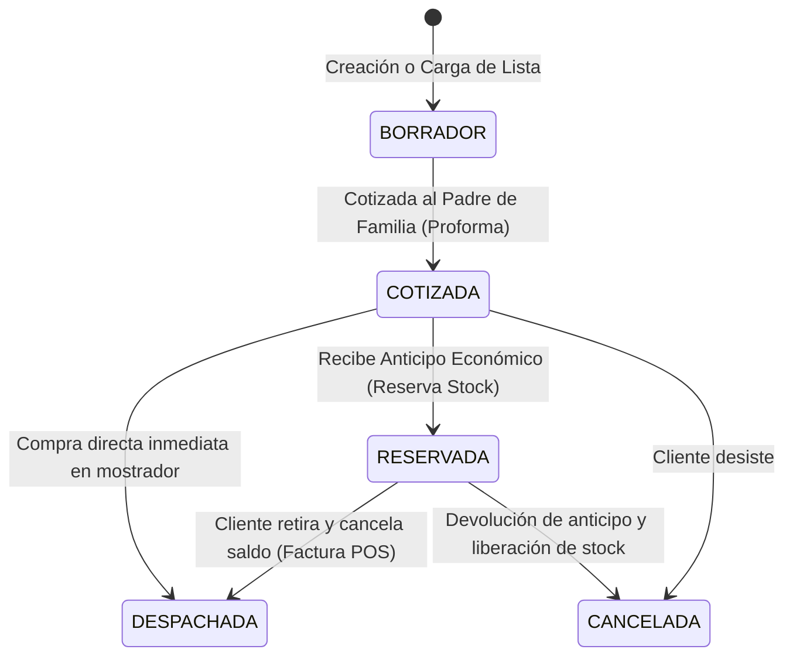

# Módulo 06: Temporada Escolar y Listas de Útiles (`school-lists`)

> **Módulo:** `school-lists`  
> **Estado:** Especificación Técnica y Plan de Implementación Aprobado  
> **Dependencias:** `catalog` (M01), `stakeholders` (M02), `inventory` (M03), `pos` (M05)

---

## 1. Objetivo y Alcance

### 1.1. Objetivo
Maximizar la velocidad de atención, la precisión en el despacho y la tasa de conversión durante las temporadas escolares pico de Ecuador (**Régimen Costa y Régimen Sierra**), permitiendo cotizar listas de útiles completas en segundos, reservar materiales con abonos previos y despacharlas/facturarlas en un solo clic.

### 1.2. Alcance
* Registro y biblioteca de **Listas Escolares Prediseñadas** por Unidad Educativa, Grado/Curso y Paralelo.
* Cotizador instantáneo de listas para padres de familia con generación de proforma imprimible y exportable para WhatsApp.
* Verificador de disponibilidad en tiempo real con motor de **Sugerencia de Sustitutos** cuando una marca o modelo específico está agotado (ej. sustituir cuaderno *Norma* por *Estilo*).
* Módulo de **Separación y Reserva**: Permite apartar los útiles físicamente en bodega recibiendo un anticipo económico (abono).
* Conversión directa de la lista escolar en una orden de venta POS liquidada y facturada en 1 clic.

### 1.3. Exclusiones
* No realiza cobros directos sin pasar por una sesión activa de caja (Módulo 05: `pos`).

---

## 2. Modelo del Dominio y Flujo Operativo



---

## 3. Diseño de Persistencia (PostgreSQL)

```sql
CREATE TYPE school_list_status_enum AS ENUM (
    'DRAFT', 
    'QUOTED', 
    'RESERVED', 
    'DISPATCHED', 
    'CANCELLED'
);

-- Instituciones Educativas (Colegios, Escuelas locales)
CREATE TABLE school_institutions (
    id UUID PRIMARY KEY,
    name VARCHAR(255) NOT NULL UNIQUE,
    city VARCHAR(100) NOT NULL,
    regime VARCHAR(20) DEFAULT 'SIERRA' NOT NULL, -- 'COSTA' o 'SIERRA'
    is_active BOOLEAN DEFAULT TRUE NOT NULL,
    created_at TIMESTAMP WITH TIME ZONE DEFAULT CURRENT_TIMESTAMP NOT NULL
);

-- Cabecera de Lista Escolar
CREATE TABLE school_lists (
    id UUID PRIMARY KEY,
    institution_id UUID REFERENCES school_institutions(id),
    grade_level VARCHAR(100) NOT NULL, -- Ej. "5to de Básica", "1ro de Bachillerato"
    academic_year VARCHAR(20) NOT NULL, -- Ej. "2026-2027"
    student_name VARCHAR(150),
    customer_id UUID REFERENCES customers(id),
    status school_list_status_enum DEFAULT 'DRAFT' NOT NULL,
    total_quoted_cents INTEGER DEFAULT 0 NOT NULL,
    advance_payment_cents INTEGER DEFAULT 0 NOT NULL, -- Abono recibido
    notes TEXT,
    created_at TIMESTAMP WITH TIME ZONE DEFAULT CURRENT_TIMESTAMP NOT NULL,
    updated_at TIMESTAMP WITH TIME ZONE DEFAULT CURRENT_TIMESTAMP NOT NULL
);

-- Ítems detallados de la lista de útiles
CREATE TABLE school_list_items (
    id UUID PRIMARY KEY,
    school_list_id UUID NOT NULL REFERENCES school_lists(id) ON DELETE CASCADE,
    product_id UUID NOT NULL REFERENCES products(id),
    presentation_id UUID NOT NULL REFERENCES product_presentations(id),
    quantity NUMERIC(10, 2) NOT NULL,
    unit_price_cents INTEGER NOT NULL,
    is_reserved BOOLEAN DEFAULT FALSE NOT NULL,
    is_delivered BOOLEAN DEFAULT FALSE NOT NULL,
    substitute_product_id UUID REFERENCES products(id)
);
```

---

## 4. Casos de Uso (Application Layer)

1. **`QuoteSchoolListUseCase`**:
   - Carga la lista de 40 a 80 artículos.
   - Comprueba stock actual en el almacén de despacho.
   - Si no hay existencia de un ítem, busca artículos de la misma categoría y unidad como sustitutos sugeridos.
   - Genera la proforma con el total desglosado (con y sin IVA).
2. **`ReserveSchoolListUseCase`**:
   - Registra el abono financiero del cliente mediante la caja POS.
   - Marca los ítems como reservados impidiendo que el mostrador común los venda a otros clientes.
3. **`FulfillSchoolListToSaleUseCase`**:
   - Transfiere todos los ítems reservados al carrito de la caja POS.
   - Deduce el anticipo previamente abonado.
   - Genera la factura electrónica SRI por el saldo restante y despacha el pedido.

---

## 5. Criterios de Aceptación (Definition of Done)

- [ ] Cargar y cotizar una lista de 50 productos en menos de 2 minutos.
- [ ] La proforma se genera en formato PDF y como mensaje estructurado listo para enviar por WhatsApp.
- [ ] Las reservas de listas bloquean unidades físicas en el cálculo de disponibilidad de mostrador.
- [ ] Liquidación de una lista reservada en caja en un solo clic.

---

## 6. Plan de Implementación Paso a Paso

* [ ] **Tarea 6.1:** Crear esquemas Drizzle para `school_institutions`, `school_lists` y `school_list_items`.
* [ ] **Tarea 6.2:** Implementar el caso de uso `QuoteSchoolListUseCase` con motor de sugerencia de productos sustitutos.
* [ ] **Tarea 6.3:** Implementar `ReserveSchoolListUseCase` con bloqueo de stock reservado.
* [ ] **Tarea 6.4:** Implementar `FulfillSchoolListToSaleUseCase` conectándolo con el motor de ventas POS.
* [ ] **Tarea 6.5:** Construir interfaz visual para cotización rápida de listas y exportación a WhatsApp/PDF.
