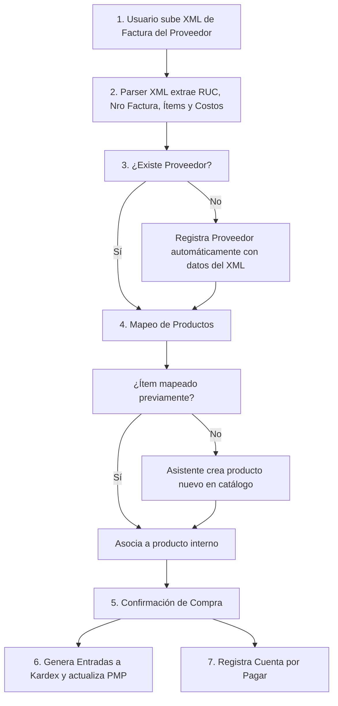

# Módulo 07: Compras y Carga Automática de Facturas SRI (`purchasing`)

> **Módulo:** `purchasing`  
> **Estado:** Especificación Técnica y Plan de Implementación Aprobado  
> **Dependencias:** `catalog` (M01), `stakeholders` (M02), `inventory` (M03)

---

## 1. Objetivo y Alcance

### 1.1. Objetivo
Automatizar el reabastecimiento de mercancía de papelería y libros eliminando la digitación manual de facturas, mediante un **Lector/Parser inteligente de archivos XML autorizados por el SRI** emitidos por distribuidores y editoriales (ej. *Papelesa, Grupo Norma, Faber-Castell, Dipac*), alimentando automáticamente el Kardex y actualizando el PMP.

### 1.2. Alcance
* Lector y validador de archivos XML de facturas electrónicas de compra autorizadas por el SRI.
* Mapeo inteligente y aprendizaje de equivalencias entre códigos de productos del proveedor y el catálogo interno de LumsaLibrary.
* Asistente de alta rápida para productos nuevos detectados en el XML de compra (asignación de categoría, unidad y margen de ganancia sugerido).
* Registro automático de la compra en el Kardex del almacén destino con recálculo exacto del PMP.
* Registro y control de **Cuentas por Pagar a Proveedores** (días de crédito, fechas de vencimiento y pagos emitidos).

### 1.3. Exclusiones
* No emite comprobantes de retención electrónica en este módulo (la orden de compra delega la retención al Módulo 04: `billing-sri`).

---

## 2. Modelo del Dominio y Flujo de Importación XML



---

## 3. Diseño de Persistencia (PostgreSQL)

```sql
CREATE TYPE purchase_status_enum AS ENUM ('DRAFT', 'CONFIRMED', 'CANCELLED');

-- Cabecera de Compra
CREATE TABLE purchases (
    id UUID PRIMARY KEY,
    supplier_id UUID NOT NULL REFERENCES suppliers(id),
    warehouse_id UUID NOT NULL REFERENCES warehouses(id),
    invoice_number VARCHAR(17) NOT NULL, -- Formato SRI: 001-001-000000123
    authorization_number VARCHAR(49),   -- Clave de acceso de la factura del proveedor
    emission_date DATE NOT NULL,
    subtotal_0_cents INTEGER NOT NULL,
    subtotal_15_cents INTEGER NOT NULL,
    total_discount_cents INTEGER DEFAULT 0 NOT NULL,
    total_iva_cents INTEGER NOT NULL,
    total_amount_cents INTEGER NOT NULL,
    status purchase_status_enum DEFAULT 'DRAFT' NOT NULL,
    xml_file_path TEXT,
    created_at TIMESTAMP WITH TIME ZONE DEFAULT CURRENT_TIMESTAMP NOT NULL
);

CREATE UNIQUE INDEX uq_supplier_invoice ON purchases(supplier_id, invoice_number);

-- Detalle de la compra
CREATE TABLE purchase_items (
    id UUID PRIMARY KEY,
    purchase_id UUID NOT NULL REFERENCES purchases(id) ON DELETE CASCADE,
    product_id UUID NOT NULL REFERENCES products(id),
    presentation_id UUID NOT NULL REFERENCES product_presentations(id),
    supplier_product_code VARCHAR(100),
    quantity_bought NUMERIC(10, 2) NOT NULL,
    unit_cost_cents INTEGER NOT NULL,
    tax_rate VARCHAR(20) NOT NULL,
    total_cents INTEGER NOT NULL
);

-- Memoria de Mapeo de Códigos de Proveedores (Para futuras importaciones automáticas)
CREATE TABLE supplier_product_mappings (
    id UUID PRIMARY KEY,
    supplier_id UUID NOT NULL REFERENCES suppliers(id) ON DELETE CASCADE,
    supplier_code VARCHAR(100) NOT NULL,
    product_id UUID NOT NULL REFERENCES products(id) ON DELETE CASCADE,
    presentation_id UUID NOT NULL REFERENCES product_presentations(id),
    created_at TIMESTAMP WITH TIME ZONE DEFAULT CURRENT_TIMESTAMP NOT NULL,
    CONSTRAINT uq_supplier_mapping UNIQUE (supplier_id, supplier_code)
);

-- Cuentas por Pagar a Proveedores
CREATE TABLE supplier_debts (
    id UUID PRIMARY KEY,
    purchase_id UUID NOT NULL REFERENCES purchases(id) ON DELETE CASCADE,
    supplier_id UUID NOT NULL REFERENCES suppliers(id),
    due_date DATE NOT NULL,
    total_debt_cents INTEGER NOT NULL,
    paid_amount_cents INTEGER DEFAULT 0 NOT NULL,
    is_settled BOOLEAN DEFAULT FALSE NOT NULL,
    updated_at TIMESTAMP WITH TIME ZONE DEFAULT CURRENT_TIMESTAMP NOT NULL
);
```

---

## 4. Casos de Uso (Application Layer)

1. **`ParseSupplierXmlInvoiceUseCase`**:
   - Lee el archivo XML y verifica que sea un comprobante válido del SRI.
   - Extrae el RUC del emisor, verifica si existe en `suppliers` o lo pre-registra.
   - Procesa cada `<detalle>` extrayendo código principal, descripción, cantidad y precio unitario.
   - Consulta `supplier_product_mappings` para pre-asociar productos conocidos.
2. **`ConfirmPurchaseUseCase`**:
   - Guarda la compra confirmada.
   - Llama a `inventory.recordPurchaseEntry()` por cada ítem para actualizar el stock físico y el costo PMP.
   - Si se definieron nuevos mapeos de productos, los guarda en `supplier_product_mappings`.
   - Genera la obligación en `supplier_debts`.

---

## 5. Criterios de Aceptación (Definition of Done)

- [ ] Importación exitosa de un XML real de distribuidora ecuatoriana sin errores de parseo.
- [ ] Detección automática de productos conocidos y memorización de nuevos mapeos.
- [ ] Actualización matemática correcta del Kardex y PMP al confirmar la compra.
- [ ] Control de alertas de facturas por pagar próximas a vencer.

---

## 6. Plan de Implementación Paso a Paso

* [ ] **Tarea 7.1:** Implementar el parser de XML oficial del SRI con librería `fast-xml-parser` (`sri-xml-parser.ts`).
* [ ] **Tarea 7.2:** Crear esquemas Drizzle para `purchases`, `purchase_items`, `supplier_product_mappings` y `supplier_debts`.
* [ ] **Tarea 7.3:** Implementar `ParseSupplierXmlInvoiceUseCase`.
* [ ] **Tarea 7.4:** Implementar `ConfirmPurchaseUseCase` orquestando el Kardex PMP.
* [ ] **Tarea 7.5:** Construir la interfaz drag-and-drop para subir archivos XML de proveedores y conciliar productos.
