# Módulo 08: Reportes Financieros, Analítica e Inteligencia Artificial (`analytics-ai`)

> **Módulo:** `analytics-ai`  
> **Estado:** Especificación Técnica y Plan de Implementación Aprobado  
> **Dependencias:** Todos los módulos previos (`catalog`, `inventory`, `pos`, `purchasing`) + SDK `@google/genai`

---

## 1. Objetivo y Alcance

### 1.1. Objetivo
Proveer visibilidad ejecutiva sobre la rentabilidad real de la librería, auditar márgenes netos basados en el costo de venta PMP, identificar productos de baja rotación (*hueso*) y potenciar la operación de mostrador y reabastecimiento estacional mediante **modelos de Inteligencia Artificial (Gemini) a través del SDK `@google/genai`**.

### 1.2. Alcance
* **Dashboard Financiero y Márgenes Reales:** Cálculo del margen de ganancia real por artículo, categoría y marca ($\text{Margen} = \text{Precio Venta} - \text{Costo PMP}$).
* **Reporte de Rotación y Mermas:** Detección de artículos estancados sin movimiento en más de 90 o 180 días para liquidaciones estratégicas.
* **Métricas de Temporada Escolar:** Comparativa de rendimiento entre temporadas (Régimen Costa vs Régimen Sierra) y ticket promedio por colegio.
* **Asistente Inteligente de Mostrador (Gemini):** Búsqueda semántica y sugerencia instantánea de sustitutos escolares para cajeros ("¿Qué cuaderno de dibujo alternativo tenemos en stock?").
* **Asistente Predictivo de Compras (Gemini):** Análisis de tendencias históricas de ventas para recomendar volúmenes óptimos de compra a distribuidores antes del inicio de clases.

### 1.3. Exclusiones
* No altera el stock ni crea registros contables directamente (solo genera análisis y recomendaciones).

---

## 2. Modelo del Dominio e Integración con Gemini

```mermaid
flowchart LR
    subgraph Data["1. Datos Transaccionales"]
        Ventas["Ventas POS"]
        Kardex["Kardex PMP"]
        Listas["Listas Escolares"]
    end
    subgraph Analytics["2. Motor Analítico"]
        Mv["Vistas Agregadas SQL"]
        Rentabilidad["Cálculo de Márgenes"]
        Rotacion["Índice de Rotación"]
    end
    subgraph AI["3. Asistente Google AI Studio"]
        Gemini["Gemini (SDK @google/genai)"]
        Recomendacion["Recomendación de Compra Temporada"]
        AsistentePOS["Sugerencia de Útiles en Mostrador"]
    end

    Data --> Analytics
    Analytics --> AI
    AI --> Dashboard["4. Dashboard Ejecutivo y Terminal POS"]
```



---

## 3. Consultas Analíticas Clave (Vistas SQL Optimizadas)

```sql
-- Vista de Rentabilidad Real por Producto
CREATE OR REPLACE VIEW v_product_profitability AS
SELECT 
    p.id AS product_id,
    p.sku,
    p.name AS product_name,
    c.name AS category_name,
    SUM(soi.quantity) AS total_units_sold,
    SUM(soi.total_cents) AS total_revenue_cents,
    SUM(soi.quantity * im.unit_cost_cents) AS total_cost_cents,
    (SUM(soi.total_cents) - SUM(soi.quantity * im.unit_cost_cents)) AS gross_profit_cents,
    CASE 
        WHEN SUM(soi.total_cents) > 0 THEN 
            ROUND(((SUM(soi.total_cents) - SUM(soi.quantity * im.unit_cost_cents))::numeric / SUM(soi.total_cents)::numeric) * 100, 2)
        ELSE 0 
    END AS margin_percentage
FROM sale_order_items soi
JOIN products p ON soi.product_id = p.id
JOIN categories c ON p.category_id = c.id
JOIN sale_orders so ON soi.sale_order_id = so.id
LEFT JOIN inventory_movements im ON im.reference_id = so.id AND im.product_id = p.id
GROUP BY p.id, p.sku, p.name, c.name;

-- Vista de Productos de Baja Rotación (Hueso)
CREATE OR REPLACE VIEW v_slow_moving_inventory AS
SELECT 
    p.id,
    p.sku,
    p.name,
    ib.current_stock_units,
    (ib.current_stock_units * ib.current_pmp_cents) AS tied_capital_cents,
    MAX(im.created_at) AS last_movement_date,
    EXTRACT(DAY FROM (CURRENT_TIMESTAMP - MAX(im.created_at))) AS days_inactive
FROM products p
JOIN inventory_balances ib ON p.id = ib.product_id
LEFT JOIN inventory_movements im ON p.id = im.product_id
WHERE ib.current_stock_units > 0 AND p.is_service = FALSE
GROUP BY p.id, p.sku, p.name, ib.current_stock_units, ib.current_pmp_cents
HAVING EXTRACT(DAY FROM (CURRENT_TIMESTAMP - MAX(im.created_at))) > 90
ORDER BY tied_capital_cents DESC;
```

---

## 4. Casos de Uso (Application Layer)

1. **`GetFinancialSummaryUseCase`**:
   - Devuelve ingresos totales, costo total de ventas y margen bruto neto en un rango de fechas.
2. **`AskStationeryAssistantUseCase` (IA)**:
   - Recibe una pregunta del cajero (ej. *"¿Qué opciones económicas de témperas tenemos para primaria?"*).
   - Inyecta en el contexto de Gemini los productos relevantes en stock.
   - Devuelve la recomendación estructurada para el cajero en tiempo récord.
3. **`PredictSeasonSuppliesDemandUseCase` (IA)**:
   - Procesa los historiales de ventas de la temporada anterior (Régimen Costa o Sierra).
   - Gemini analiza patrones de consumo y sugiere cantidades a pedir a distribuidores para evitar quiebres de stock.

---

## 5. Criterios de Aceptación (Definition of Done)

- [ ] Margen de ganancia calculado exactamente contra el costo PMP registrado en el momento de la venta.
- [ ] Detección precisa de artículos sin venta en más de 90 días con cálculo de capital congelado.
- [ ] Asistente Gemini responde en menos de 2 segundos consultas sobre stock y recomendaciones escolares.
- [ ] Gráficas de ventas y flujo de caja con filtros por día, mes y temporada.

---

## 6. Plan de Implementación Paso a Paso

* [ ] **Tarea 8.1:** Crear vistas SQL y consultas optimizadas para rentabilidad y productos de baja rotación.
* [ ] **Tarea 8.2:** Implementar `GetFinancialSummaryUseCase` con desglose por formas de pago.
* [ ] **Tarea 8.3:** Implementar `AskStationeryAssistantUseCase` conectándolo con `getGeminiClient()` en `src/lib/gemini.ts`.
* [ ] **Tarea 8.4:** Implementar el caso de uso predictivo para compras de temporada escolar (`PredictSeasonSuppliesDemandUseCase`).
* [ ] **Tarea 8.5:** Construir el Dashboard ejecutivo interactivo con gráficos (Recharts / Tailwind).
